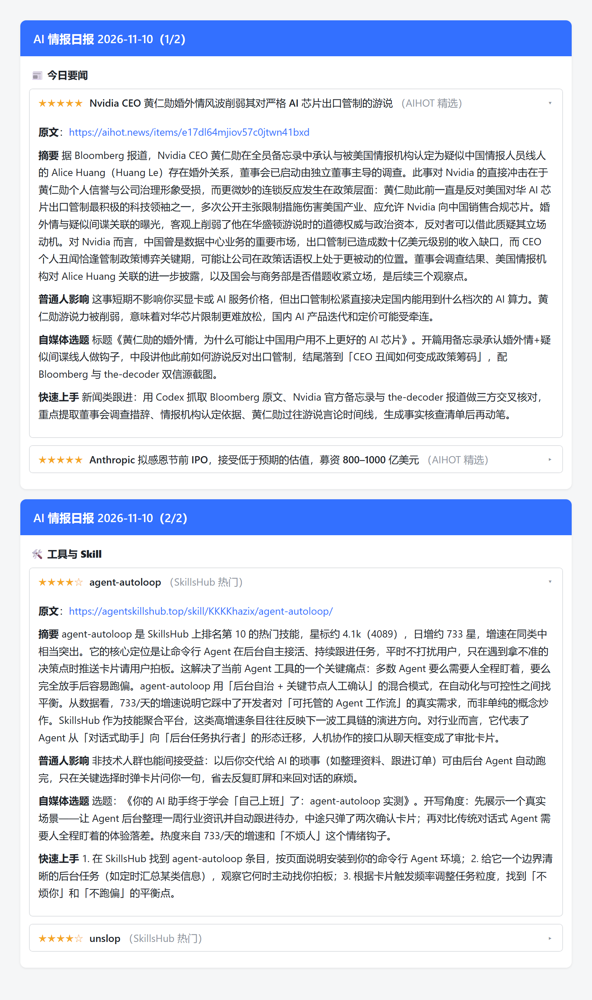

# AI 信息情报官

> 仓库：`github.com/edccce64/ai-news-radar` · License: MIT

每天定时采集 AI 新闻 / AI 工具 / 开源 Skill，经 AI 筛选判重 + 逐条深度加工后，以**两区折叠卡片**推送到飞书群。

- **📰 今日要闻** —— 中文源（AIHOT / 机器之心 / 新智元 / 36Kr AI 等），同事件自动聚拢成一条
- **🛠 工具与 Skill** —— agent-skills-hub / GitHub Trending / Show HN，按「冒头度」排序

每条内容输出四段：**摘要（250-400 字）/ 普通人影响 / 自媒体选题 / 快速上手** —— 直接是可用的选题稿，不用自己再读一遍原文。

[](https://www.python.org/)
[](LICENSE)
[](https://github.com/edccce64/ai-news-radar/actions/workflows/daily.yml)
[](https://github.com/edccce64/ai-news-radar/actions/workflows/tests.yml)
[](https://github.com/edccce64/ai-news-radar/stargazers)
[](https://edccce64.github.io/ai-news-radar/)

## 目录

- [效果](#效果)
- [快速开始](#快速开始)
- [飞书机器人配置](#飞书机器人配置)
- [部署到 GitHub Actions](#部署到-github-actions每日自动推送)
- [项目结构](#项目结构)
- [数据源](#数据源)
- [数据来源与第三方条款](#数据来源与第三方条款)
- [常见问题](#常见问题)
- [开发](#开发)
- [更新日志](#更新日志)
- [谁在用](#谁在用)
- [License](#license)

---

## 效果

飞书群里收到的是折叠卡片，标题常驻、点开看正文：



> 上图由**真实推送数据 + 真实 LLM 加工结果**渲染而成，可用 `tools/render_preview.py` 复现。

在线预览：<https://edccce64.github.io/ai-news-radar/>

飞书自定义机器人请求体上限 20 KB，本项目自动按 18 KB 拆卡。

---

## 快速开始

### 1. 准备 Python 环境

需要 **Python 3.10+**。

> ⚠️ Windows 上 PATH 里的 `python` 可能是微软商店的 0 字节占位符，直接敲 `python` 会静默失败。
> 建好虚拟环境后一律用 `.venv\Scripts\python.exe` 执行，**不要激活**（执行策略会拦）。

```powershell
python -m venv .venv
.venv\Scripts\python.exe -m pip install -r requirements.txt
```

### 2. 配置密钥

```powershell
copy .env.example .env
# 用编辑器打开 .env 填真值，保存为 UTF-8 无 BOM（PowerShell 的 Out-File 会带 BOM）
```

| 变量 | 必填 | 说明 |
|---|---|---|
| `LLM_PROVIDER` | 是 | `deepseek` 或 `mimo` |
| `DEEPSEEK_API_KEY` | 用 deepseek 时 | https://platform.deepseek.com |
| `MIMO_API_KEY` / `MIMO_BASE_URL` / `MIMO_MODEL` | 用 mimo 时 | 三项一起填 |
| `FEISHU_WEBHOOK_URL` | 是 | 见下方「飞书机器人配置」 |
| `FEISHU_SECRET` | 否 | 机器人开了「签名校验」才填 |
| `GITHUB_TOKEN` | 否 | 不填则跳过 GitHub 源；Actions 上自动有 |

### 3. 跑

```powershell
# 全链路，不推送、不写库（看加工结果）
.venv\Scripts\python.exe main.py --dry-run

# 全链路，真推送 + 写 SQLite
.venv\Scripts\python.exe main.py

# 只发一条测试消息到飞书群（验证 webhook 与签名都通）
.venv\Scripts\python.exe main.py --test-push

# 不想切目录的话，双击项目根目录的 test-push.bat 即可
```

---

## 飞书机器人配置

1. 打开目标飞书群 → **设置** → **群机器人** → **添加机器人**
2. 选 **自定义机器人**，起个名字（比如「AI 信息情报官」）
3. 复制 **Webhook 地址**，填进 `.env` 的 `FEISHU_WEBHOOK_URL`
4. **安全设置**建议三选一：
   - **自定义关键词**：填 `AI`（卡片标题里有）
   - **签名校验**（推荐）：把 Secret 填进 `.env` 的 `FEISHU_SECRET`，代码会自动加签
   - **IP 白名单**：不适用于 GitHub Actions

> ⚠️ Webhook 地址等同密码，**不要提交进 Git、不要发到公开渠道**。谁拿到都能往你群里发消息。
> 本项目已确保：飞书接口报错时抛出的错误里**不含 webhook URL**，不会随日志泄漏。

**限制**：自定义机器人请求体上限 **20 KB**（超报 `9499`）、限频 **100 次/分 + 5 次/秒**。本项目已做 18 KB 自动拆卡 + 卡间 1.2 秒间隔。

### 开启签名校验（推荐，防 webhook 被冒用）

Webhook 地址等同密码。勾选签名校验后，请求必须带正确签名才能发出去，地址泄漏了也发不出消息。

**手机就能操作**：飞书 App → 目标群 → 右上角「⋯」→ **群设置** → **群机器人** → 点进「自定义机器人」→ **安全设置** → 勾选 **签名校验** → 点「复制」拿秘钥。

> 桌面端路径：群名右侧机器人图标 → 自定义机器人 → 安全设置 → 签名校验。
> 秘钥随时可以「重置」，重置后记得重新配一次。

**按这个顺序做，错了也不会让日报停摆：**

1. 在飞书勾选签名校验，复制秘钥
2. 写进本地 `.env` 和 GitHub Secret（一行命令，秘钥不回显、不进历史）：

   ```powershell
   .\set-feishu-secret.ps1
   ```

3. 本地验证（会往群里发一条测试消息，消息里会写明当前是「带签名」还是「无签名」）：

   ```powershell
   .venv\Scripts\python.exe main.py --test-push
   ```

   或者双击项目根目录的 `test-push.bat`（不用切目录）

   - 群里收到消息 → 配置成功
   - 报 `19021 sign match fail` → 秘钥没对上，回飞书页面重新复制一次
   - 报「无签名」 → `.env` 里的 `FEISHU_SECRET` 没读到，检查是不是存成了 BOM 编码

4. GitHub Actions 上也要生效：上面的脚本已经同时写好了 GitHub Secret，不用额外操作


---

## 部署到 GitHub Actions（每日自动推送）

> 本仓库地址：`github.com/edccce64/ai-news-radar`。下面的 `<owner>/<repo>` 换成你自己的仓库名。

### 1. 建仓库并推代码

```powershell
gh repo create <owner>/<repo> --public --source=. --remote=origin --push
```

### 2. 配置 Secrets

```powershell
.\set-secrets.ps1                    # 自动识别当前仓库
.\set-secrets.ps1 -Repo <owner>/<repo>   # 或显式指定
```

它会把 `.env` 里的值写进 GitHub Secrets（值经 stdin 传递，不进命令行、不进历史）。

> `GITHUB_TOKEN` **不用配**，Actions 每次运行自动提供。

### 3. 定时

#### 主力：第三方定时服务（cron-job.org，免费）

GitHub 自带的 `schedule` **不可靠**：官方只承诺「最多延迟 15 分钟」，实测能拖 5 小时 47 分、甚至整条漏跑。用第三方服务调 `workflow_dispatch` 来触发。

**一次性配置（约 5 分钟）：**

1. **建 GitHub Token** —— https://github.com/settings/personal-access-tokens/new
   - **Repository access** 只选你自己的仓库
   - **Permissions → Actions** 选 `Read and write`
   - 生成后**立刻复制**（只显示一次）。⚠️ 这是 token，别贴给别人、别进 Git。

2. **注册 cron-job.org** —— https://console.cron-job.org/signup （免费，只要邮箱）

3. **建 Cronjob**，按下面填：

   | 字段 | 值 |
   |---|---|
   | Request URL | `https://api.github.com/repos/<owner>/<repo>/actions/workflows/daily.yml/dispatches` |
   | Request Method | `POST` |
   | Request Body | `{"ref": "master"}` |
   | Content-Type | `application/json` |

   **Custom Headers**（一行一个）：
   ```
   Authorization: Bearer 刚才那个TOKEN
   Accept: application/vnd.github+json
   X-GitHub-Api-Version: 2022-11-28
   ```

   **Schedule**：每天 **09:07**（把 Timezone 设成 `Asia/Shanghai` 直接填北京时间）
   想再加一道兜底就建第二个：每天 **09:37**。

   > Token **直接填在 cron-job.org 里，不要发给任何人**。它经手对话记录 = 泄密。

4. **验证**：cron-job.org 里点「Run now」，然后看 GitHub Actions 有没有出现一条 `workflow_dispatch` 运行。

> ⚠️ 仓库改名后，GitHub 会给旧地址做重定向，但**带 `Authorization` 头的 API 调用不一定跟随重定向**。
> 改过仓库名的话，记得把 cron-job.org 里的 Request URL 同步成新地址。

#### 兜底：GitHub 自带 cron（保留，作为第二道）

`daily.yml` 里仍配了三档，但**分位刻意避开 `0` 分**：

| cron（UTC） | 北京时间 |
|---|---|
| `7 1 * * *` | 9:07 |
| `27 1 * * *` | 9:27 |
| `47 1 * * *` | 9:47 |

**为什么是 7/27/47 不是 0/20/40**：GitHub 文档明写整点是高负载时段（*High load times include the start of every hour*），实测 `0 1` 的任务拖到 06:47 才跑。而且**同一 workflow 同时只保留一个待跑实例** —— 一个被塞进队列排很久时，后面的兜底点会被跳过，所以三个点要拉开距离。

> 多个触发点会重复跑，但**真正的每日一次闸门是 `store.finished_today()`**（按北京自然日记录完成标记）：北京当天第一个跑完的会推，之后的直接退出。`data/seen.db` 的去重只认 link，**挡不住「同一件事换个来源再推一次」**，别指望它。

#### 手动补推

```powershell
gh workflow run daily.yml -R <owner>/<repo>
```

跑挂了会**自动往飞书群发一条告警**。

---

## 项目结构

**代码**

| 文件 | 职责 |
|---|---|
| `config.py` | 非密钥配置：RSS 源、三个问题、TOP_N、预算、评分门槛、prompt |
| `rss_fetcher.py` | RSS 抓取 + pubDate 过滤 |
| `api_fetcher.py` | GitHub Search API + HN Algolia（非 RSS 的工具源） |
| `llm.py` | 评分判重 + 逐条加工（带重试退避、JSON 容错） |
| `store.py` | SQLite 记已推送，跨次去重 |
| `feishu.py` | 两区卡片组装 + 拆卡 + 推送 |
| `main.py` | 编排全流程，`--dry-run` |
| `tests/test_core.py` | 核心逻辑单测（标准库 unittest，无需额外依赖） |
| `data/seen.db` | 状态库，**commit 回仓库**（Actions 跨次去重靠它） |

**配置与文档**

| 文件 | 职责 |
|---|---|
| `.env` / `.env.example` | 密钥（`.env` 不入库）与配置模板 |
| `requirements.txt` | 运行时依赖（已 pin 版本） |
| `pyproject.toml` | ruff 静态检查与格式化规则 |
| `.editorconfig` / `.gitattributes` | 缩进、换行符、编码的统一约定 |
| `set-secrets.ps1` | 一次性把 `.env` 的值写进 GitHub Secrets |
| `set-feishu-secret.ps1` | 单独写入飞书签名秘钥到 `.env` + GitHub Secret（终端输入不回显） |
| `test-push.bat` | 双击就往群里发一条测试消息（不用切目录） |
| `CONTRIBUTING.md` / `SECURITY.md` / `CHANGELOG.md` | 贡献指南 / 安全策略 / 变更记录 |
| `.github/workflows/` | `daily.yml`（定时推送）、`tests.yml`（push 跑单测） |

**改三个问题的文案 = 改 `config.py` 的 `THREE_QUESTIONS`**，其他文件不用动。

---

## 数据源

**要闻（只用中文源）**

| 源 | 通道 | 说明 |
|---|---|---|
| AIHOT 精选 | RSS | 跨源中文编辑稿，带摘要，主力源，独力兜底 |
| 机器之心 / 新智元 / 量子位 / AI前线 / 夕小瑶 / PaperWeekly | RSS（微信公众号桥） | 纯 AI 中文媒体，带摘要 |
| 36Kr AI / 少数派 AI | RSS（RSSHub） | AI 专属频道，镜像偶发 503 |
| **AI 聚合（80+ 源）** | **JSON** | 24 小时快照，带中文标题，**无摘要** |

**工具与 Skill**：agent-skills-hub 热门 + 新收录（RSS）/ GitHub Trending（Search API）/ Show HN（Algolia）

> **每源条数可单独配**：`config.py` 的 `RSS_FEEDS` 里加 `top_n`，不填则用全局 `TOP_N`。

### 关键取舍（改动前先看）

- **工具排序按「冒头度」不是绝对热度**：SkillsHub 用相对增速 `日增/总星`，GitHub 用 `星/创建天数`，Show HN 用评论数。否则几十万星的老项目天然霸榜。
- **工具源不做 pubDate 过滤**：热门榜的 pubDate 不代表新鲜度。
- **同事件判重走 LLM，不用字符串相似度**：实测同一事件不同媒体的标题相似度只有 0.24–0.57，用 0.9 阈值会把去重整个做废。
- **单源失败跳过**，不影响其他源；AIHOT 可独力兜底（`TOP_N=10`）。
- **AI 聚合源没有摘要字段**（只有标题+链接），当「捞头条」用；素材不足时模型会返回 `skip`，属预期行为。
- **AI 聚合源优先取有中文标题的条目**（其翻译覆盖仅约 55%）。

---

## 数据来源与第三方条款

请使用者自行确认以下事项，本项目不对第三方源的内容与可用性负责：

- **RSS 内容版权归原发布方所有**。本项目只抓取标题与摘要用于生成个人摘要，**不复制全文、不做二次分发**。
- **agent-skills-hub**（`zhuyansen/agent-skills-hub`）的 MIT 许可**只覆盖其源码**，托管的目录数据与 API 不在 MIT 范围内。本项目**仅在运行时抓取**其目录数据，**不在仓库里分发**任何目录数据。
- **RSSHub 镜像**（如 `rsshub.rssforever.com`）与**微信公众号 RSS 桥**都是第三方公共服务，有限流、随时可能失效。请勿高频请求，必要时自建镜像。
- **各数据源的使用条款由你自己承担**。商用或二次分发前请自行核实版权与授权。
- **数据流向**：抓到的标题与摘要会发送给你配置的 LLM 服务（DeepSeek / MiMo）做加工，请按对方的数据政策判断是否可用。
- 不要把上游快照（如聚合站的 `latest-24h.json`、`archive.json`）打进仓库或再分发。

---

## 常见问题

| 现象 | 原因 |
|---|---|
| 敲 `python` 没反应 | PATH 上是商店占位符，用 `.venv\Scripts\python.exe` |
| `.ps1` 中文全乱码、报语法错 | PS 5.1 对无 BOM 脚本按 GBK 解析。`.ps1` 要 UTF-8 **带 BOM**，`.env` 要 **无 BOM** |
| 推送报 `9499` | 请求体超 20 KB，检查拆卡逻辑 |
| 推送报 `19021` | 签名不匹配，`FEISHU_SECRET` 填错或时间戳偏差超 1 小时 |
| 推送报 `19024` | 关键词未命中：机器人开了「自定义关键词」，而卡片内容里没有那个词 |
| 推送报 `11232` | 飞书高压限流（整点/半点高发），代码会自动重试一次 |
| 只推了很少几条 | 多半是 RSSHub 镜像 503 挂了，AIHOT 在独力兜底 |
| Actions 不触发 | GitHub schedule 本身不准点，看三档兜底有没有任一触发；或手动 `gh workflow run` |
| 一天被推了两次 | 去重闸门按北京自然日生效，若在跨日边界手动触发可能重复；用 `store.finished_today()` 的记录核对 |

---

## 开发

```powershell
# 跑单测
.venv\Scripts\python.exe -m unittest discover -s tests -v
```

静态检查与格式化用 [ruff](https://docs.astral.sh/ruff/)（不在运行时依赖里，规则写在 `pyproject.toml`）：

```powershell
pip install ruff
ruff check .      # 检查（行宽 100、py310 目标）
ruff format .     # 统一格式
```

贡献前请读 [CONTRIBUTING.md](CONTRIBUTING.md)。

---

## 更新日志

见 [CHANGELOG.md](CHANGELOG.md)。

---

## 谁在用

用上了这个项目？欢迎在 [Discussions](https://github.com/edccce64/ai-news-radar/discussions) 里发一条「我在用」，
说说你的源配置、过滤偏好或踩过的坑 —— 对后来者比自己摸索省事得多。

也欢迎开 [Issue](https://github.com/edccce64/ai-news-radar/issues) 提 Bug 或要新功能。

---

## License

[MIT](LICENSE) © 2026 edccce64
